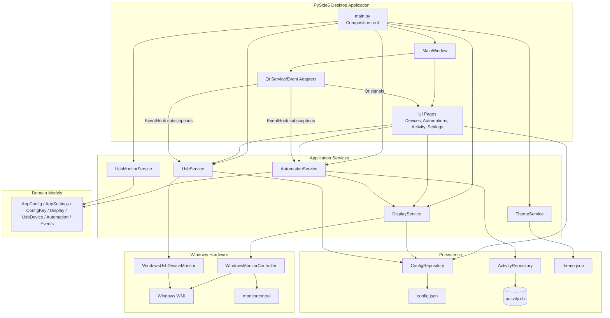
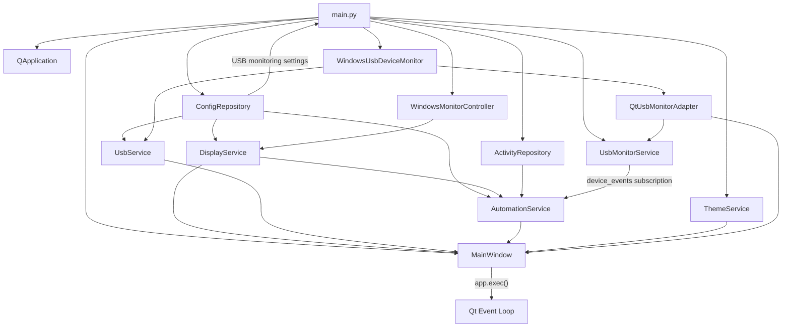
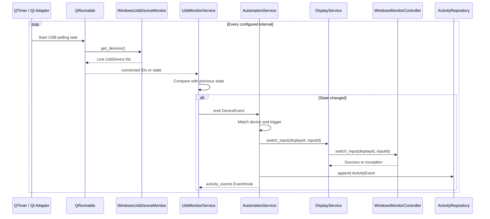
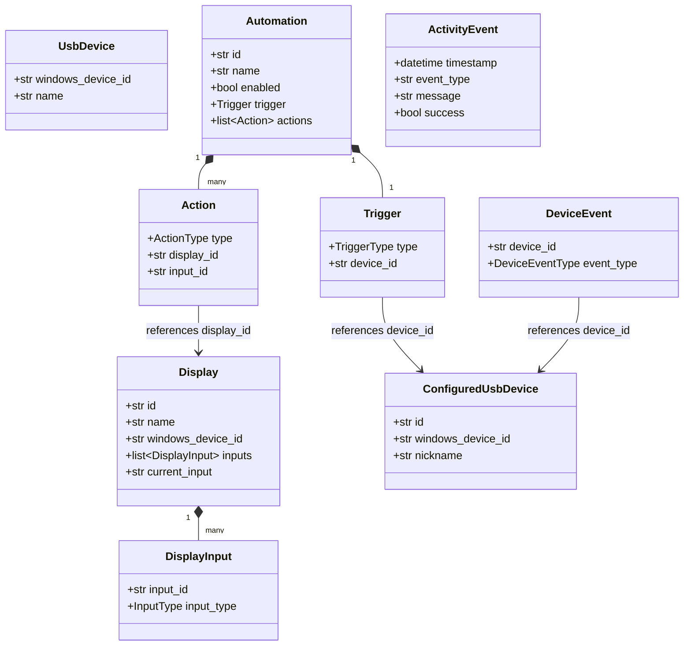

This document describes the architecture of Monitor Switcher, including the main data models, hardware integration, persistence layer, event flow, and UI structure.

## Architecture diagrams

### Component architecture



### Startup and dependency wiring



### USB event and automation sequence



### Domain model relationships



## 1. System overview

Monitor Switcher is a Windows desktop application with a layered architecture:

- hardware layer: Windows USB and monitor discovery / control
- domain model layer: lightweight dataclasses describing displays, USB devices, automations, and events
- service layer: repository access and business logic
- UI layer: PySide6 pages and widgets

The app runs as a single desktop process and uses an event-driven loop to monitor USB state changes. When a configured device connects or disconnects, the app checks any matching automations and executes display input changes.

## 2. Runtime flow

The startup sequence in `main.py` is roughly:

1. Create the Qt application.
2. Build the theme service and apply the stylesheet.
3. Instantiate Windows-specific hardware controllers.
4. Load configuration from `config.json` and create the display service.
5. Create the automation service and activity repository.
6. Create the Qt USB monitor adapter and start polling when enabled.
7. Open the main window.

The runtime flow is:

```text
QtUsbMonitorAdapter (Qt timer + worker pool)
   -> UsbMonitorService.handle_state()
   -> publishes DeviceEvent through EventHook
   -> AutomationService.handle_device_event()
   -> matches trigger
   -> DisplayService.switch_input()
   -> WindowsMonitorController.switch_input()
   -> monitorcontrol input source change
```

## 3. Data models

The domain layer is intentionally small and centered on dataclasses.

### 3.1 Display hierarchy

Defined in `app/models/display.py`.

- `InputType` is an enum for supported monitor input families:
  - HDMI
  - ANALOG
  - DVI
  - DP
  - COMPOSITE

- `DisplayInput`
  - `input_id`: the input identifier used by monitorcontrol / Windows
  - `input_type`: the normalized category for the input

- `Display`
  - `id`: internal ID used in config and automation rules
  - `name`: display label shown in the UI
  - `windows_device_id`: Windows PnP device ID
  - `inputs`: list of supported inputs
  - `current_input`: last known active input

This structure is persisted to `config.json` and used to map monitor IDs to actual hardware devices.

### 3.2 USB device models

Defined in `app/models/usb_device.py`.

- `UsbDevice`
  - represents a discovered device that is connected right now
  - fields: `windows_device_id`, `name`

- `ConfiguredUsbDevice`
  - represents a user-saved USB device configuration
  - fields: `id`, `windows_device_id`, `nickname`

The UI keeps a distinction between a live connected device and a configured device entry so the same physical hardware can appear in multiple states.

### 3.3 Automation model

Defined in `app/models/automation.py`.

- `TriggerType`
  - `DEVICE_CONNECTED`
  - `DEVICE_DISCONNECTED`

- `ActionType`
  - `SWITCH_INPUT`
  - `DO_NOTHING`

- `Trigger`
  - `type`: trigger event type
  - `device_id`: which configured USB device should trigger it

- `Action`
  - `type`: action kind
  - `display_id`: target display
  - `input_id`: target input source on that display

- `Automation`
  - `id`, `name`, `enabled`, `trigger`, `actions`

The automation format is intentionally simple: the app currently focuses on a single event type and a single action type.

### 3.4 Event models

Defined in `app/models/device_event.py` and `app/models/activity_event.py`.

- `DeviceEvent`
  - carries `device_id` and `event_type` (`connected` or `disconnected`)

- `ActivityEvent`
  - stores timestamp, event type, message, and success flag

The activity log is written to SQLite so the UI can present a time-bounded event history without losing detail.

## 4. Persistence and storage

### 4.1 JSON configuration

`ConfigRepository` in `app/services/config_repository.py` saves and loads the app's state from `config.json`.

`main.py` creates one app-scoped repository and injects it into services and UI components. `AppConfig` and `AppSettings` in `app/models/config.py` model the persisted data, while `ConfigKey` selects a typed collection or setting.

The repository provides typed `get_config`, `update_config`, `add_config`, and `remove_config` operations. Collection operations validate their model types and use stable IDs for removal. Updates are persisted before a `config_changed` event is emitted, allowing services and UI components to refresh without keeping stale startup snapshots.

The JSON document contains these collections:

- `usb_devices`
- `automations`
- `displays`

It also stores application settings under `settings`. The `AppConfig` model validates JSON values and converts between the typed models and the persisted document.

### 4.2 SQLite activity log

`ActivityRepository` in `app/services/activity_repository.py` uses SQLite to store the event log in `activity.db`.

Schema:

```sql
CREATE TABLE IF NOT EXISTS activity_events (
    id INTEGER PRIMARY KEY AUTOINCREMENT,
    timestamp TEXT NOT NULL,
    event_type TEXT NOT NULL,
    message TEXT NOT NULL,
    success INTEGER NOT NULL
)
```

It supports:

- append event rows
- load recent events in a time range
- clear all activity history

The activity page uses a `days` filter (`7`, `30`, `90`, `365`, or all) to decide which entries to show while preserving older rows in the database.

## 5. Hardware layer

### 5.1 USB monitor abstraction

Defined in `app/hardware/usb.py`.

- `UsbDeviceMonitor` is an abstract interface with a single method: `get_devices()`

The concrete implementation is `WindowsUsbDeviceMonitor` in `app/hardware/windows_usb.py`.

It enumerates all present Windows PnP devices, filters those whose `DeviceID` starts with `USB\\`, and converts them into `UsbDevice` objects.

### 5.2 Display monitor abstraction

Defined in `app/hardware/monitor.py`.

- `MonitorController` defines `switch_input(display_id, input_id)`
- `DisplayDiscovery` defines `get_displays()`

The concrete implementation is `WindowsMonitorController` in `app/hardware/windows_monitor.py`.

That class combines:

- `win32com.client` to enumerate `Win32_PnPEntity` devices and locate matching monitors
- `monitorcontrol` to query and change monitor input sources
- a map of display IDs to live `monitorcontrol` monitor objects

The controller supports reading available inputs for each monitor, detecting the current input, and switching the display to a selected source.

## 6. Services layer

### 6.1 DisplayService

`DisplayService` in `app/services/display_service.py` is responsible for:

- loading persisted displays from config
- discovering active displays if no config exists
- refreshing current input state
- switching a display to a requested input

This service keeps the UI and automation logic decoupled from the raw monitor APIs.

### 6.2 UsbService

`UsbService` in `app/services/usb_service.py` handles configured USB devices
and publishes `devices_changed` through a framework-neutral event hook when
the saved device set changes. The Qt service-event adapter translates this
notification for UI pages.

It exposes:

- `get_devices()`: current live USB devices
- `get_configured_devices()`: saved USB devices from config
- `add_device()`, `update_device()`, `remove_device()`

### 6.3 UsbMonitorService

`UsbMonitorService` in `app/services/usb_monitor_service.py` compares USB
snapshots to the previous state without depending on Qt. The
`QtUsbMonitorAdapter` in `app/adapters/qt/usb_monitor_adapter.py` owns the Qt
timer and worker-pool enumeration (default 500 ms). Its enabled state and
interval can be changed from Settings and are persisted in the `settings`
object in `config.json`.

When the state changes, it publishes a `DeviceEvent` through `EventHook` with
either:

- `connected`
- `disconnected`

This is the core trigger path for automations.

### 6.4 AutomationService

`AutomationService` in `app/services/automation_service.py` is the central,
framework-independent automation engine.

It receives device events, checks whether any automation matches the event, and if so executes the configured actions.

The logic is:

- ignore disabled automations
- match by `device_id`
- match by connected/disconnected event type
- call `DisplayService.switch_input()` for each action
- log automation-trigger and action outcomes; raw device events are not stored

The service also exposes `get_activity_history()` and
`clear_activity_history()` for the Activity page, and publishes activity
updates through an `EventHook`.

### 6.5 ThemeService

`ThemeService` in `app/services/theme_service.py` loads and validates application palettes from `theme.json` and builds a stylesheet for the PySide6 UI. It supports predefined themes such as:

- dark
- light
- hacker
- harlequin

The selected theme is saved between sessions.

## 7. UI layer

The app uses PySide6 widgets organized around a main window and multiple pages.

### 7.1 MainWindow

`app/ui/main_window.py` creates the sidebar and stacked pages:

- My Devices
- Find My Device
- Automations
- Activity
- Settings

It uses `QtServiceEventAdapter` to translate framework-neutral service events
into Qt signals for the Activity, My Devices, and Find My Device pages.

### 7.2 Pages

- `MyDevicesPage`: displays configured displays and saved USB devices
- `FindMyDevicePage`: lets the user detect and add a USB device
- `AutomationsPage`: add/edit/delete automations
- `ActivityPage`: shows filtered event history
- `SettingsPage`: theme and activity history controls

The UI is designed to keep the core device and automation state in services while the page widgets remain thin wrappers around that state.

## 8. Libraries and dependencies

The project uses the following packages:

- `PySide6` for the desktop UI
- `monitorcontrol` for monitor input enumeration and switching
- `pywin32` for Windows COM / WMI access
- `Pillow` for image support and UI-related utilities
- `pystray` as a tray helper option in the project ecosystem
- `sqlite3` (standard library) for activity persistence
- `json` and `pathlib` (standard library) for config persistence

## 9. Current design constraints and extension points

The project is intentionally narrow and practical, but a few design constraints matter:

- it is Windows-specific and not cross-platform
- the automation system currently watches only a single USB monitor loop in `main.py`
- automation triggers are limited to device connect/disconnect
- action types are limited to switching display inputs
- display discovery depends on monitor enumeration behavior on each machine

The architecture is structured to be expanded:

- additional trigger types can be added to `TriggerType`
- additional action types can be added to `ActionType`
- new hardware adapters can be introduced behind the monitor/USB abstractions
- more complex automation logic can be introduced in the service layer without changing the UI drastically

## 10. Summary

Monitor Switcher is a small automation tool for Windows desktops that translates USB hardware events into monitor input changes. The architecture is intentionally simple: a hardware abstraction layer, a thin service layer, a dataclass-based domain model, and a PySide6 UI backed by config and SQLite persistence.
